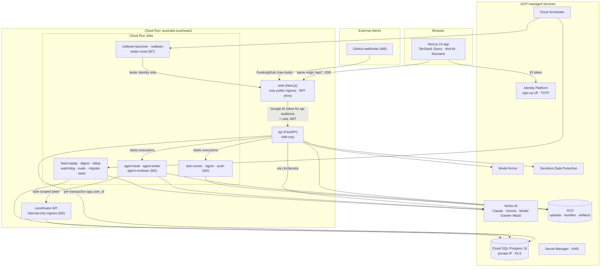
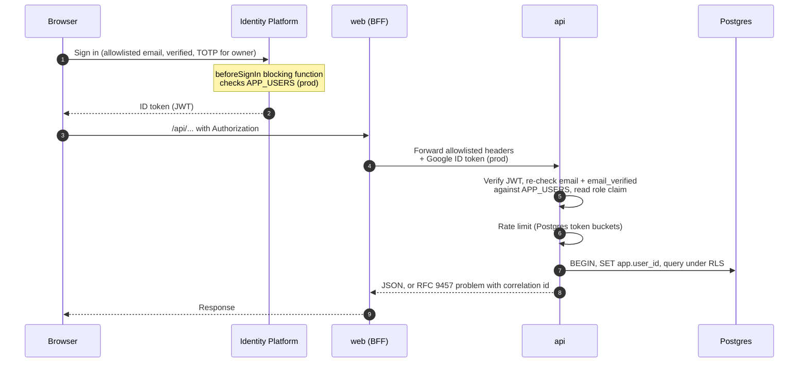
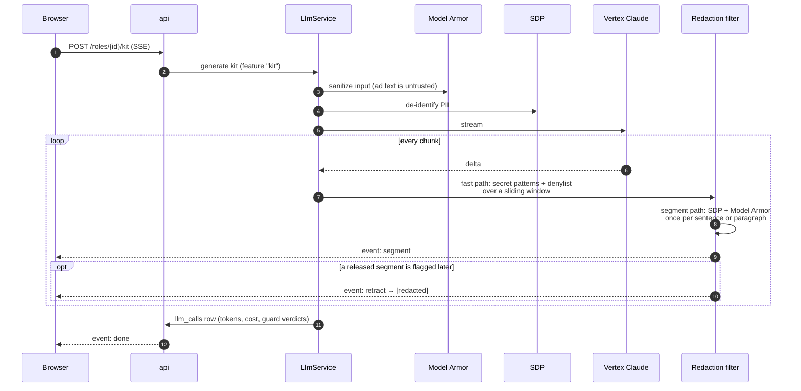
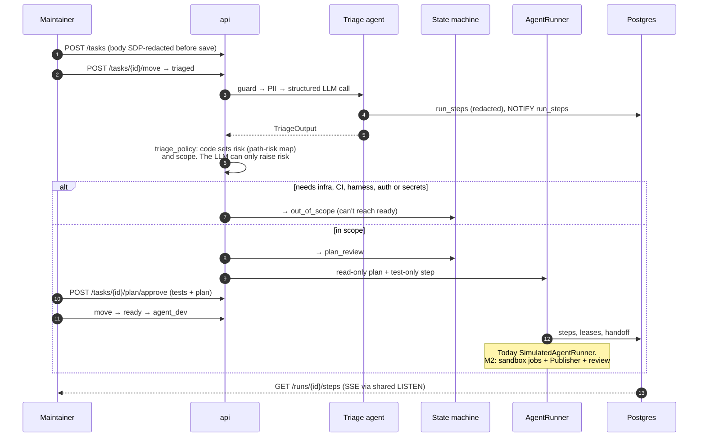

# Architecture

This doc describes the system as built and as provisioned. The reasons behind each choice are in
`plan.md` and `adr/`. The rules code must follow (layers, error model, AI calls, streaming) are
**normative in `standards/architecture.md`**; this doc cites their IDs and does not restate them.
HTTP shapes are normative in `api/openapi.yaml`, and tables in `data-model.md`.

Status markers: **(M2)**, **(M3)** and so on mean "provisioned or specified, not yet running";
see [Built vs planned](#built-vs-planned).

## System overview

Every arrow from `api` to a paid or live service sits behind a mode switch, and the default
for each is offline. See [Runtime modes](#runtime-modes-and-provider-wiring).

## Modules

### web (Next.js 16, TypeScript strict)

- Routes in `web/src/app/`: `(app)/` holds the signed-in pages (dashboard, roles, contacts,
  employers, dev board, settings). `sign-in/` and `auth/action/` (password reset and email
  verification links, our own handler instead of the hosted Firebase page) are the only pages
  that work without a session. There's no sign-up page. `/pipeline`, `/analytics` and `/targets`
  redirect (removed or renamed).
- **Dashboard** follows job-seeker's main page: a sticky campaign column (plan, weekly tasks,
  log activity) on wide screens, headline tiles, an expandable Job analytics section, status
  tabs with role cards (score, evidence block, actions), and 30-second polling. The top bar
  shows scan status with Scan now and a Health panel (jobs, LLM spend, site usage).
- **BFF proxy** (ADR-0007). `src/app/api/[...path]/route.ts` and
  `src/app/hooks/github/route.ts` forward to `api` through `lib/api/bff`. The proxy forwards
  an allowlist of headers, streams SSE unbuffered, passes webhook bodies through raw for HMAC
  checks, and in prod attaches a Google ID token for the `api` audience. The browser never learns
  the `api` URL.
- Layers `app → features → components → lib`, enforced by dependency-cruiser (ARCH-40..42).
  `features/` covers `roles`, `contacts`, `targets` (shown as Employers), `dashboard`,
  `devboard`, `settings`, `session`, `health` and `scan`. Shared pieces live in `components/`
  (e.g. `EvidenceBlock`, `ExperienceForm`, `Dialog`, `ResearchProgress`) and `lib/` (`session`,
  `research`, `evidence`, `experience`, `scan`, `search`, `useStickToBottom`). `lib/search`'s
  `useSearchQuery` backs the Contacts and Employers search boxes: debounced `q`, kept in `?q=`. All API access goes through `lib/api` over the generated client in
  `lib/api/generated/`, which is never hand-edited.
- SSE is consumed by `lib/sse.ts`, which handles `segment`, `retract`, `step`, `done` and
  `error` events (ARCH-30).
- `lib/analytics.ts` batches page views (route templates only), product events and Web Vitals to
  `POST /api/events`. CSP comes from `lib/csp.ts` (`connect-src 'self'`).

### api (Python 3.12, FastAPI)

- **Composition root** `app/main.py`. `build_container` turns `Settings` into concrete
  adapters once at startup. `build_app` installs problem handlers, middleware and the root
  routers, then `app/compose/install_all` loads every feature area (`compose/<area>.py`:
  `devboard`, `jobs`, `scan`, `health`, `user_settings`). Each area wires its own adapters and routers,
  so adding an area doesn't touch `main.py`.
- **Layers** (ARCH-01..06, enforced by import-linter):
  - `api/`: thin routes per area (`api/jobs/*`, `api/devboard/*`), RFC 9457 mapping in
    `api/problems.py`, and auth plus rate limits in `api/security.py`.
  - `domain/`: pure business logic. `domain/jobs/` holds scoring, kits, chat, CRM, campaign,
    rejections, follow-ups, the dashboard and insights, the main-page summary, the evidence
    test, the simulated scan, profile documents, experience records and the LinkedIn import. `domain/devboard/` holds the state machine, triage
    policy, path-risk map, leases, plans, fractional ranking and the simulated runner. Ports
    live in `domain/ports/`.
  - `adapters/`: `db/` (SQLAlchemy 2, one module per store, `notify.py` for LISTEN/NOTIFY),
    `llm/` (routing, providers, ledger), `auth/` (Identity Platform JWT), `fakes/` (one per
    port, ARCH-04), `scrapers/` (the seed feed behind `JobSource`), the campaign-plan loader,
    storage (`storage_local.py`, `storage_gcs.py`), PDF text (`pdf.py`, pypdf), cover-letter
    PDFs (`pdf_letter.py`, ReportLab, behind the domain's `LetterRenderer`) and an
    egress-allowlisted HTTP client (`http.py`).
  - `guards/`: Model Armor and SDP clients (`gcp.py`), secret patterns (`patterns.py`), and the output
    redaction filter (`redaction.py`).
  - `agents/`: in-app agents `triage/` and `research/`, built on the LLM port's tool use.
  - `jobs/`: batch entry points, each run as `python -m app.jobs.<name>`.
- **Startup checks.** The lifespan refuses to serve if the DB role bypasses RLS
  (`assert_rls_enforced`), then starts the single per-process `LISTEN` connection (ARCH-31).
  In prod, `Settings` refuses to load unless auth, guards and LLM are all in their real modes
  (`settings.py` `_prod_is_locked_down`).
- `/docs` and `/redoc` are off everywhere. The generated spec is served at `/api/openapi.json`
  except in prod.

### LLM layer (`adapters/llm`)

- `LlmService` is the only way to call a model (ARCH-20). Per call it routes the feature through
  `ai/models.yaml`, runs Model Armor on the input, de-identifies PII with SDP, calls the
  provider, validates structured output with one retry and then the fallback model (ARCH-21),
  guards the output, and writes an `llm_calls` row with tokens and cost but no prompt or output
  text. A daily per-feature budget (`ai/models.yaml`, USD like the stored cost) stops calls
  once it's spent. The user-facing money is AUD (`domain/money.py`): the monthly budget
  (`llm.monthly_budget_aud`, default `LLM_BUDGET_MONTH_AUD`) is compared with spend converted
  at `USD_TO_AUD`; the health panel, dashboard KPI (`llm_spend_aud`), spend series and
  `UsageSummary` show AUD. Dev-board run costs stay USD.
- Providers: `vertex-claude` (AnthropicVertex), `vertex-maas` (Model Garden serverless open
  model for `digest`, `followup` and `rejection_analysis`, falling back to Claude Sonnet),
  `vertex-gemini` (stub until M3), plus `replay`, `record` and `synthetic` for offline work.
- Tool use (`tool_turns.py`, `providers/vertex_claude_tools.py`) powers the research and triage agents.

### coordinator (internal-only)

- Built locally (`backend/src/app/coordinator/`, compose service `coordinator`, profile
  `agents`); in prod it's provisioned as its own Cloud Run service with
  `INGRESS_TRAFFIC_INTERNAL_ONLY`, because ingress is set per service.
- A small Starlette HTTP API (ADR-0009), schema in `docs/features/coordinator.md`:
  `GET /v1/task`, `POST /v1/leases/{claim,renew,release}`, `/v1/steps`, `/v1/handoff`, `/v1/help`,
  plus `/healthz`. JSON, RFC 9457 errors, 413 for anything over a cap (never truncated), 422 for
  malformed input. The writer calls it through thin in-process Agent SDK tools
  (`sandbox/writer/coordinator_tools.py`).
- Auth: `jrc1` tokens (HMAC-SHA256 with `COORDINATOR_TOKEN_KEY`; task, run, expiry,
  audience), valid only for the task's active run. Every request runs as the task owner under
  RLS, via the restricted login (`COORDINATOR_DATABASE_URL`); responses are redacted and capped at
  2k tokens. Steps are stored and NOTIFY'd, so the board streams them live.
- Known gaps: owner lookup reads the task under a maintainer scope (no `TaskStore` owner-lookup
  port yet), and release must name every held lease (no partial release in `LeaseStore`).

### Sandbox, Publisher and review (M2–M4)

Specified in `plan.md` "Sandboxing" and "Code review"; the jobs are provisioned in
`infra/envs/prod/jobs.tf`. In short:

- `agent-*` jobs run on gen2 microVMs with deny-all egress apart from the Google API VIP, with
  no GitHub token, no DB credentials and no app secrets. Input and output are git bundles in GCS.
- The Publisher has three parts. `test-runner` runs repo code with no KMS, Secret Manager or
  GitHub access. `signer` runs no repo code: it checks bundle SHAs, frozen acceptance tests,
  test-infrastructure files and the path allowlist, then signs with KMS. `push` checks the
  signature and is the only job that can read the deploy key.
- Local sandbox (`dev.sh --with-agents`, Docker):
  - The writer image (`sandbox/writer/`) has every dependency baked in. It runs
    `--read-only --cap-drop ALL --security-opt no-new-privileges` as a non-root user on the
    internal `jobradar_sandbox` network.
  - Its only way out is the squid egress proxy, which allows one endpoint per mode:
    `*.googleapis.com` for Vertex, or the local `llm-proxy`.
  - `llm-proxy` (`sandbox/llm-proxy/`) holds the real model credential. It accepts only
    per-task HMAC tokens with an expiry, a token budget and a model allowlist, and logs metadata
    only, so the sandbox never holds a key.
  - `check.sh` runs `sandbox` (unit tests, lint, types) and `sandbox-isolation` (real-container
    proofs, skipped when Docker isn't running).
- The board runs on `SimulatedAgentRunner` (`domain/devboard/simulation.py`) by default. With
  `AGENT_SANDBOX=docker` (set by `dev.sh --with-agents`; refused in prod), `DockerAgentRunner`
  (`adapters/agents/`) bundles the working tree, mints the `jrt1` and `jrc1` tokens, runs the
  writer with `sandbox/run.sh`'s hardening, enforces the timeout and kill switch, validates the
  handoff and publishes the result through `LocalGitHost` (`adapters/codehost/`) as
  `agent/<task>-<run>` in a scratch bare repo (`~/.cache/jobradar/agent-remote`). The project's
  own `.git` is never touched. Inside, the writer runs a Claude Agent SDK loop
  (`AGENT_MODE=agent`; `stub` for the plumbing test) with an allowlisted Bash, workspace-only
  file tools, edits limited to granted leases, and the standards pack read from the base commit.

## End-to-end flows

### Authenticated request (every call)

The allowlist is checked twice: by the blocking function, and again by `api` on every request,
in case the console or the function drifts. Locally `AUTH=fake` uses the same two-account model.

### Kit generation (streaming with redaction)

`api/stream_guard.py` wraps every SSE body: an exception after the stream has started becomes a
typed `error` event and a clean close, never a cut connection. Role chat uses the same path.

### Dev-board card

Every move goes through `domain/devboard/state_machine.py` with an optimistic `version`
(ARCH-11). Only one active top-level run per task is allowed (partial unique index), and
`POST /tasks/{id}/kill` stops the run and releases its leases.

### Company research agent

`POST /targets/{id}/research-runs` starts `agents/research`. It's a manual tool-use loop: each
turn the model calls one tool over the user's own records, or Claude's server web search when
`RESEARCH_WEB_SEARCH` is on, or gives a final `ResearchAnswer`. Tool outputs are guarded before
the next turn. Every turn, tool call and result summary is redacted and written to
`run_steps` (shared with the dev board since migration 0002; research steps are owner-only
under RLS), then streamed to the UI. The run stops at 6 turns or $0.50.

### Scheduled jobs

| Job | Schedule (prod) | Does |
| --- | --- | --- |
| `scan` (alias `feed-replay`) | every 15 min | Simulated scraping through the `JobSource` port: the seed feed (`PgSeedFeed` in `adapters/db/scan.py`, `MemorySeedFeed` without a database) releases the next 5 roles from the hidden `role_pool`, then dedupe → save → score within the daily cap. Real Seek/LinkedIn scrapers will implement the same port. Also runs on demand (`POST /scan`, maintainer) |
| `digest` | nightly | Open-model digest summary |
| `rollup` | nightly | KPI rollups; purges `web_events` older than 90 days |
| `watchdog` | every 15 min | Reclaims expired leases; alerts if Identity Platform has accounts beyond `APP_USERS` |
| `evals` | nightly (cheap) | Scoring, triage and open-model gate evals. The job and schedule are provisioned, but there's no `app.jobs.evals` entry point yet; only the triage eval exists (`backend/tests/evals/devboard/`) |
| `redteam-launcher` | weekly, paused unless `redteam_enabled` | Mints a tester token, resets the tester tenant, starts `redteam` **(M7)** |

Locally the API runs the scan in-process every `SCAN_INTERVAL_MINUTES` (dev.sh sets 15),
single-flight with manual scans via an advisory lock. Run any job by hand with
`cd backend && uv run python -m app.jobs.<name>`.

## Data

Tables, conventions and indexes are in `data-model.md`. In summary:

| Kind | Tables | Access |
| --- | --- | --- |
| User-owned (U) | `roles`, `role_kits`, `role_events`, `role_chats`, `role_chat_files`, `role_evidence`, `role_recruiters`, `rejections`, `followups`, `contacts`, `targets`, `research_runs`, `campaign_*`, `experience*`, `profile_documents`, `role_pool`, `user_settings`, `llm_calls` | RLS `user_id = current_setting('app.user_id')`, `FORCE`d; the app role isn't the owner |
| Shared (S) | `dev_tasks`, `task_events`, `task_triage`, `task_plans`, `runs`, `run_steps`, `leases`, `lease_waits` | Both accounts read; maintainer-only writes enforced in the domain |
| System (Sys) | `users`, `llm_budget_usage`, `rate_limit_buckets`, `web_events`, `job_runs`, `scan_runs`, `app_state` | Written by the app or jobs, never returned raw |

- Real-time updates use `NOTIFY` with ids only. Subscribers re-read rows under their own RLS
  scope, so a notification can't leak another user's data.
- Mutable rows carry `version`; ordered rows carry a fractional `rank` (`collate "C"`).
- Uploads (CVs, LinkedIn profile PDF) and chat files go through the `Storage` port: GCS in prod
  (`STORAGE=gcs`), local disk under `.artifacts/storage` otherwise; `profile_documents` rows hold
  only metadata and the object key.
- Seed data (`dev.sh --reset-db`) loads into the owner's tenant only: 300 visible roles plus the
  rest in `role_pool`, released 5 per scan, and the two demo CVs (`seed/documents/`) as the
  owner's technical and leadership profile documents. The CVs go through
  `ProfileDocumentService.upload` (guard, PII de-identification, Storage, manifest), like a
  user's upload; a slot that already holds a document is skipped. The owner's "Your extra
  skills" come from `seed/owner-settings.json`, set only while empty. The tester starts empty.
- Kit downloads (`domain/jobs/kit_files.py`): `getKitCoverLetterPdf` renders the kit's
  `cover_note` as a one-page A4 letter (name and contact from the profile settings, date in the
  display time zone, To/Re fallbacks, `**bold**` lead-ins); `getKitCvPdf` streams the stored CV
  for the role's track (leadership for `exec`, else technical, falling back to the other slot).
  Both are default-tier GETs on the caller's own role (RLS), `no-store`, attachment or inline.
- Contacts and targets take `q`: a case-insensitive substring search (contacts: first, last
  and full name, company, position, email; targets: name, why, approach, caveat, notes), with
  LIKE wildcards escaped, combined with the other filters and pagination (`TextSearch` port
  value; `ILIKE` in Postgres).
- Experience records (`experience` + `experience_entries`, job-seeker's model): the requirement
  a record answers plus 1 to 10 entries `{context, detail}`, one per role or project, in order
  (`created_at` steps by a microsecond per entry). Labels are positional (`E<n>`, `E<n>.<k>`).
  Prompts see each record as its requirement with one "context: detail" line per entry; the
  evidence test cites records by id, and a record's `uses` counts the roles whose stored
  `role_evidence` shows a must-have from it. `listExperience` also returns entry contexts: the
  roles parsed from the caller's stored CV text (`domain/jobs/cv_roles.py`), then "Personal
  project" and "Other".
- Migrations are Alembic, in `backend/migrations/` (human-only).

## Runtime modes and provider wiring

Everything is resolved once in `build_container` (`app/main.py`). The defaults are offline, and
prod validation refuses anything else.

| Setting | Values (default first) | Prod must be | Notes |
| --- | --- | --- | --- |
| `LLM` | `replay`, `vertex`, `record` | `vertex` | `replay` reads `backend/tests/fixtures/llm`; `record` wraps live providers and writes fixtures |
| `LLM_REPLAY_MISS` | `error`, `synthesize` | `error` | `dev.sh` defaults to live models (`LLM=vertex`); only when you opt into `LLM=replay` does it set `synthesize`, so new local data still gets (labelled) answers |
| `CLAUDE_BACKEND` | `vertex`, `anthropic` | `vertex` | `anthropic` is local-only (e.g. while Vertex quota is pending) |
| `GUARDS` | `fake`, `gcp` | `gcp` | `gcp` needs the Model Armor template and the three SDP templates |
| `AUTH` | `fake`, `identity_platform` | `identity_platform` | |
| `DATABASE_URL` | unset → in-memory stores | required | |
| `RESEARCH_WEB_SEARCH` | `false`, `true` | either | Claude server tool `web_search_20250305` |
| `REVIEW` (`dev.sh`) | `claude-only`, `cross-model` | — | Gemini reviewer **(M3)** |
| `RATE_LIMIT_SCALE` | `1.0` … `20.0` | `1.0` | Local e2e only; can only loosen |
| `STORAGE` / `STORAGE_BUCKET` | `local`, `gcs` | `gcs` + bucket | Profile documents and uploads |
| `SCAN_INTERVAL_MINUTES` | unset (no in-process scan) | unset | Local only; prod uses Cloud Scheduler |
| `CAMPAIGN_CONFIG` | `config/campaign.yaml` | either | Point at a private plan outside the repo |

All outbound HTTP goes through `allowlisted_client`, which only reaches the Model Armor and
Model Garden hosts for the configured regions.

## Infrastructure

All GCP state is OpenTofu (≥ 1.8, client-side state encryption with KMS). Agents may run
`fmt`, `validate` and `plan` with mocks only; nothing is applied from this repo by an agent.

- **`infra/bootstrap/`**: project, billing link, APIs, state bucket, WIF pool with two GitHub
  OIDC providers (deploy, review), Artifact Registry, billing budget. GitHub resources are
  gated by `enable_github` (ADR-0008).
- **`infra/envs/prod/`** wires the modules:
  - `network`: VPC, Direct VPC egress, deny-all egress firewall for the `sandbox`, `publisher`
    and `redteam` tags, Private Google Access.
  - `vpc_sc`: perimeter plus `restricted.googleapis.com`, when an Organization exists (ADR-0006
    covers the fallback).
  - `cloudsql`: Postgres 16 `db-f1-micro`, private IP only, IAM DB auth, PITR.
  - `run_service`: `web` (public), `api` (IAM-only, invoked by `web`), `coordinator`
    (internal-only).
  - `run_job`: one service account per job; sandbox jobs get no identifiers or secrets in
    their environment.
  - `identity_platform`, `model_armor`, `sdp`, `kms`, `secrets`, `scheduler`, `monitoring`
    (uptime checks, SLOs, burn-rate alerts, log-based metrics), and a Cloud Tasks
    `agent_dispatch` queue.
- **`infra/policy/`**: Conftest rules (no public SQL IP, no SA keys, no public IAM, sign-up
  off, no secrets in sandbox jobs). **`infra/tests/`**: `tofu test` against mocks.
- **No load balancer** (ADR-0005): `run.app` URLs only, with `web` as the single public
  service (ADR-0007).
- **CI** (`.github/workflows/`, written but not active until the initial commit): `ci.yml`,
  `security-review.yml` (via `workflow_run`, Vertex-only credentials), `agent-pr.yml`,
  `deploy.yml` (plan → environment approval → apply → migrate → canary → seed → provision).

### Local

`scripts/dev.sh` gets a database from `scripts/dev-db.sh` (the `docker-compose.yml` Postgres 16
when Docker is reachable, otherwise an embedded Postgres via `pgserver`). With Docker it also
starts `fake-gcs` and a Squid egress proxy that only allows `*.googleapis.com`; without it the
backend uses local storage. It then runs migrations and the seed, regenerates the API client, and
runs `uvicorn app.main:create_app --factory` on :8000 and `next dev` on :3000.

## Testing topology

Per `standards/testing.md`. No test touches the network; LLM calls replay fixtures.

| Suite | Location | Covers |
| --- | --- | --- |
| Unit, property | `backend/tests/{unit,property}` | Domain logic, state machine, ranking, leases (Hypothesis) |
| Contract | `backend/tests/contract` | Routes and response shapes against `api/openapi.yaml` (in-process; `schemathesis` is a dev dependency but no test uses it yet) |
| Integration | `backend/tests/integration` | Postgres adapters, RLS, LISTEN/NOTIFY against the server in `DATABASE_URL` (skipped without it) |
| Evals | `backend/tests/evals` | Labelled sets per AI feature; only the dev-board triage eval exists so far |
| Web unit | `web/src/**/*.test.ts(x)` | Components, hooks, `lib/` (Vitest) |
| E2E | `web/tests/e2e` | Playwright against the running `dev.sh` (live LLM by default; `LLM=replay` for offline runs) |
| Infra | `infra/tests`, `infra/policy` | `tofu test`, Conftest |

`scripts/check.sh` runs every gate. `--list` shows step ids, and `--only <ids>` runs a subset.

## Key constraints (restated from `AGENTS.md` and `standards/`, not relaxed)

- Spec-first: HTTP changes start in `api/openapi.yaml`, then `scripts/gen-api.sh`. Generated
  code is never hand-edited.
- Domain code imports no adapters, frameworks or the database (ARCH-01).
- Every model call goes through `LlmService` with guards in and out; untrusted text is a
  delimited data block, never part of the system prompt (ARCH-20..22).
- Every user-facing output (API, SSE, findings, PR text) passes the redaction filter, and
  agent steps fail closed (SEC-06).
- Exactly two accounts, no registration; the API re-checks the allowlist on every request.
- No project identifiers, owner details or PII anywhere in the repo, the bundle or responses;
  `/healthz` returns `{"status":"ok"}` only.
- Agents never merge or deploy. The dev board accepts `web`/`api` work only; anything touching
  infra, the harness, guards, auth, migrations or lockfiles is `out_of_scope`.

## Built vs planned

| Area | Now | Next |
| --- | --- | --- |
| Job search: CRUD, scoring, kits, chat, rejections, follow-ups, campaign, research | Running locally (M1) | — |
| Dashboard (job-seeker layout), Health panel, dev-board metrics | Running locally (M1) | — |
| Settings (profile, CVs, experience, LinkedIn import, scoring, follow-ups, kits) | Running locally | — |
| Evidence test (per-requirement ✓/≈/✗ with verified quotes) | Running locally | — |
| Scanning | Simulated from seed data (`PgSeedFeed`) | Real Seek/LinkedIn scrapers behind `JobSource` (after the demo) |
| Sign-in | Identity Platform email/password locally (two accounts) | Same in prod |
| Dev board: CRUD, drag-and-drop, state machine, triage, plan review | Running, with `SimulatedAgentRunner`; sandboxed Docker runs, coordinator and Claude agent loop built locally (`--with-agents`) | M2: Publisher checks, Claude review, diff view |
| Cross-model review (Gemini) | `vertex-gemini` stub | M3 |
| Multi-agent teams, lease map, overhead metric | Lease tables and domain logic exist | M4 |
| MCP (user-facing server, coordinator, harness) | Dropped (ADR-0009) | None |
| Infra as code | Modules, prod env, policy and `tofu test` written | M6: applied at the initial commit |
| Red team | Jobs and schedule provisioned (paused) | M7 |
